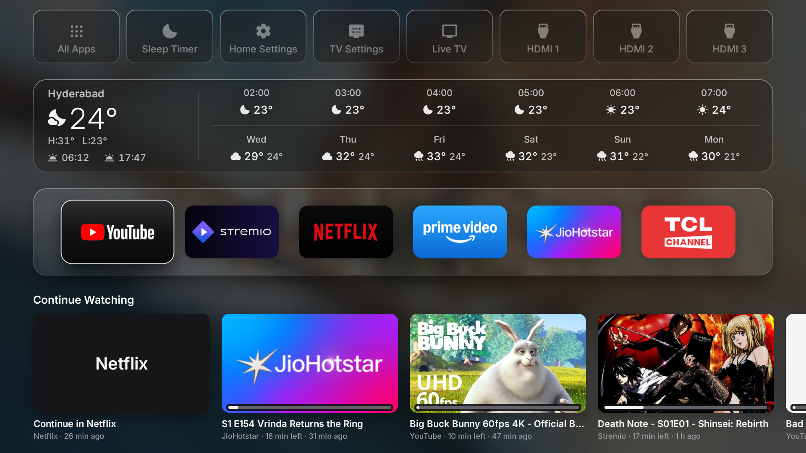
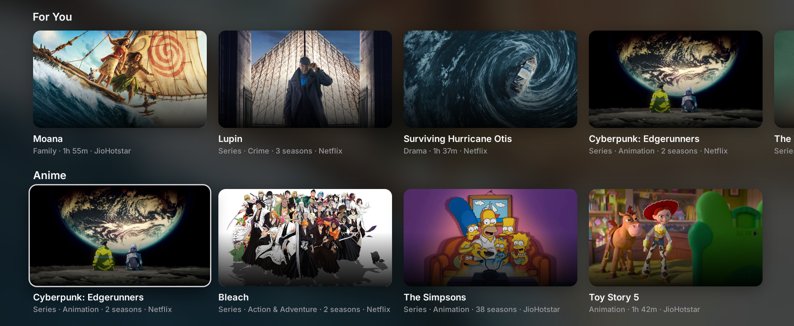
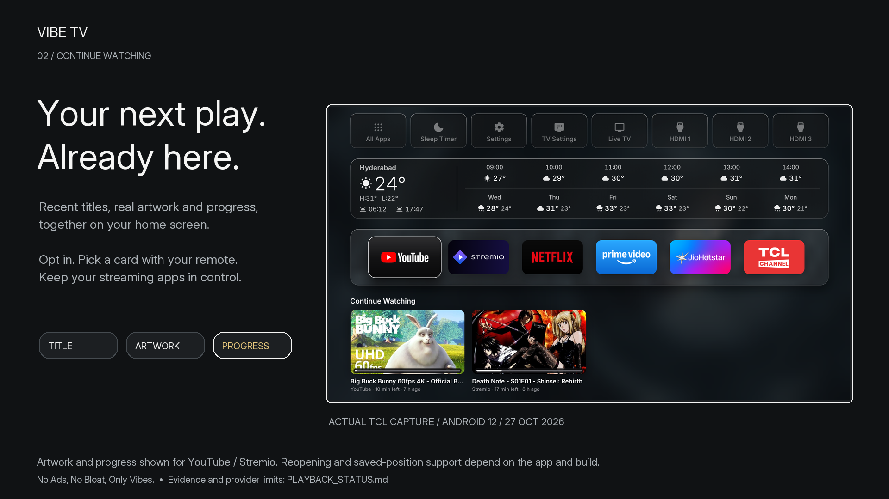
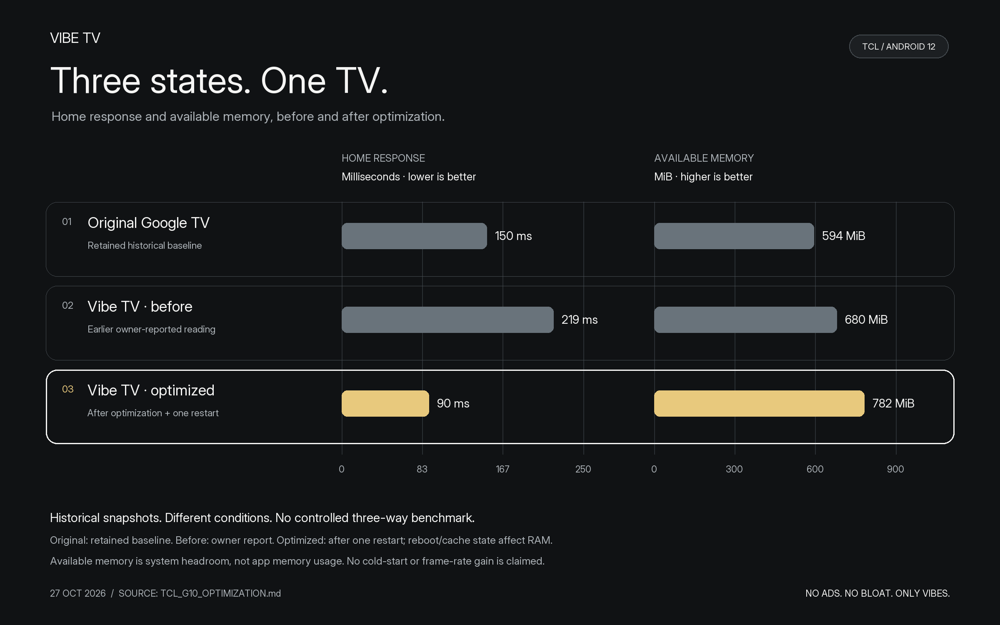

# Vibe TV

**No Ads, No Bloat, Only Vibes.**

An Android TV home for your apps, recommendations and unfinished watching. Built on [Free My TV](https://github.com/simbasjungles/free-my-tv), with credit to its creators.

[Install](INSTALLATION.md) · [Features](FEATURES.md) · [Hardware & apps](COMPATIBILITY.md) · [Documentation](documentation/INDEX.md) · [Wiki](https://github.com/pukrvi/vibe-tv/wiki) · [Contribute](CONTRIBUTING.md)



TCL Android 12 capture from `3e382d0`. [Build details and provider limits](documentation/SCREENSHOTS.md).

## Recommendations from your apps



*Detail from an earlier TCL capture of the existing TMDB shelves. The new Stremio/Kitsu engine is still in development.*

The current For You, Anime, Movies and TV Shows shelves use TMDB picks filtered to installed services. They need your TMDB key. Hold OK on a title to hide it.

A larger recommendation engine using Stremio catalogs is in development. Its new shelves and app routing will be documented after the implementation merges and passes device tests. [Recommendation guide and release status](documentation/FEATURE_STORIES.md#recommendations).

## Continue Watching on Home



See recent titles with artwork and progress, then choose a card with your remote. Enable it in Settings, Widgets, Continue Watching. Hold OK to remove a card.

YouTube and Stremio artwork/progress are verified on our TCL. Exact-title and saved-position reopening depend on the app; Netflix and Prime still have metadata limits. [Working examples and app-by-app results](documentation/FEATURE_STORIES.md#continue-watching).

## Performance on our TCL



The snapshots show Home response changing from 219 to 90 ms and available memory from 680 to 782 MiB after optimization and a restart. These readings came from different conditions. The Google TV values are historical, and reboot/cache state affects RAM.

A separate controlled test measured warm Home returns at 80 versus 63 ms, about 21% lower. Better cold starts and typical frame times were not established. [Full data, percentage graphics and test method](documentation/TCL_G10_OPTIMIZATION.md).

## Stremio catalog add-ons

Two catalog integrations are being developed: Anime Kitsu and Streaming Catalogs. They supply discovery metadata; they are not a general plug-in installer or a video-stream resolver.

Contributors can build and test another catalog adapter in code. Support for an arbitrary add-on has to be verified; it is not promised by these two integrations. [Add-on scope and contribution requirements](documentation/ADDONS.md).

## Fewer launcher ads, optional cleanup

Vibe TV has no sponsored launcher rows or autoplaying launcher promos. In the TCL support test, Google feedback, Play Movies and printing were disabled reversibly. Calendar sync and protected TV services stayed enabled.

Streaming apps keep their own ads and privacy practices. The cleanup does not block all TCL telemetry or provide a measured tracker-blocking count. [Visual comparison, audit and recovery](documentation/FEATURE_STORIES.md#ads-and-optional-collection).

## Try it or contribute

Follow [installation](INSTALLATION.md) to build this fork. A generic build has no private configuration or TMDB recommendations:

```sh
./build.sh --generic
```

Vibe TV 1, Simba (Free-My-TV) and Lamplight are selectable homes. Vibe TV 1 has section ordering and visibility controls; Google TV remains the recovery choice. The primary test target is TCL Smart TV Pro, Android 12, at 1920 × 1080. Other hardware and the inherited LG/Samsung builds need their own test reports.

Settings says Vibe TV; Android's installed app label remains Free My TV, package `io.freemytv`, APK `FreeMyTV.apk`. Updates need the same signing key. No tagged Vibe TV binary release is claimed here.

If you fork or test it, please report the exact model, firmware, commit and app versions, with what worked and what failed. Start with [CONTRIBUTING.md](CONTRIBUTING.md) or the [hardware report](.github/ISSUE_TEMPLATE/hardware_report.yml).

The wiki is generated from these same guides. [Publication workflow](documentation/WIKI.md) · [Editable assets and video plan](documentation/feature-assets/ASSET_GUIDE.md) · [Privacy](PRIVACY.md) · [Security](SECURITY.md) · [Credits](CREDITS.md)

[MIT license](LICENSE). Preserve upstream notices when redistributing.
