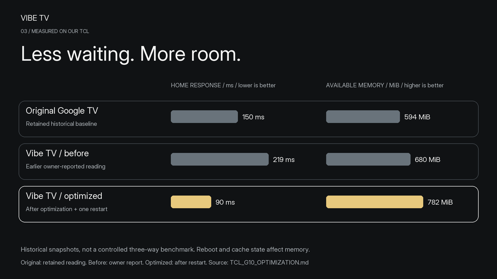

# Vibe TV feature stories

[Project](../README.md) · [Editable assets / video handoff](feature-assets/ASSET_GUIDE.md)

Recommendations and Continue Watching are the headline product stories. Performance and an ad-free launcher with optional cleanup support them. This document describes actual behavior and keeps future work separate; it does not claim that Vibe TV is the first or only app offering these ideas.

## Recommendations

The landed baseline offers For You, Anime, Movies and TV Shows, with TMDB picks filtered to installed services and a long-OK hide action. It requires the configured TMDB key. This is the current product, not a promise that every service's private recommendation API or account history is available.

The separate Stremio/Kitsu engine is in active development. Its source feeds, deduplication/season identity, category planner, availability checks, routing priorities and refresh rules are still being implemented and tested. A prototype/planner result alone does not establish a landed on-TV feature.

The recommendation hero image is intentionally held until the implementing chat provides:

1. A merged commit/PR and the final feature scope actually included.
2. A reviewed actual-device screenshot showing the new rows and provider labels, with public/test content where possible.
3. Evidence that selecting a recommendation opens the intended app/title, plus unresolved routing and availability limits.
4. Data-source/privacy notes, key requirements, platform/device scope and capture provenance.

After these arrive, update `feature-assets/evidence.json`, add the approved source screenshot, populate the short copy and limitations, run `python3 tools/render_feature_assets.py`, then update README and the wiki. The renderer requires the implementation commit on fetched `origin/main` before producing that scene. Retain provider-specific caveats and avoid claims about exclusive industry capability without comparative research.

## Continue Watching

The scene uses `documentation/screenshots/home-playback.png`, a reviewed public TCL capture from runtime `3e382d0`. It shows real YouTube and Stremio title/artwork/progress cards. The vector frame, headline and labels can be animated independently; the screenshot is a raster layer.

The row is opt-in under Settings → Widgets. Hold OK to remove a saved item; history retention is two days for YouTube and ten days for other supported services, at most twelve entries. Data comes from what apps expose, so support differs per provider.

PR #28's exact-episode/saved-position work is a separate implementation until merged. Its inspected Stremio test used saved S01E01 position 478752 ms and observed S01E01 PLAYING at 482002 ms after selecting it following S01E02. Those numbers are media-session evidence, **not an on-screen timestamp we can fabricate into a screenshot**. Current YouTube builds that expose no stable ID can require title search and an extra selection; avoid universal one-press resume claims. The published scene illustrates the existing row rather than declaring the unmerged hotfix landed.

## Performance

Use the [measured data and formulas](performance/README.md), the existing full comparison/percentage images, or the new `feature-assets/performance.svg` scene. The values are historical snapshots with different conditions. Keep measurement labels visible during any animation; neither cold-start improvement nor consistently faster frames is established.

## Stremio catalog add-ons

[Anime Kitsu and Streaming Catalogs](ADDONS.md) are the two catalog adapters being developed. They read discovery metadata. Other adapters require contributor code and tests; there is no arbitrary add-on installer. The [draft diagram](feature-assets/catalog-addons.png) labels that scope.

## Ads and optional collection

The privacy scene contrasts an inherited **stock-home illustration** (`docs/assets/before.webp`) with an actual TCL Vibe home capture. This is a visual comparison of home composition from different sources, not a same-device before/after experiment.

Verified claims: Vibe TV does not add sponsored launcher rows; optional Google feedback, Play Movies and printing were disabled reversibly during the TCL optimization test; Calendar and protected components remained enabled. Whole-system ad/tracker blocking, packets blocked, tracking reduction percentages and removal of all TCL telemetry were not established. Streaming apps keep their own advertising and data practices.

See [optimization/recovery](TCL_G10_OPTIMIZATION.md), [the privacy audit](TCL_G10_AUDIT.md) and [project privacy](../PRIVACY.md) for the distinctions. Do not convert “three optional packages disabled” into “three trackers blocked”; Movies and printing are not demonstrated tracking services.
