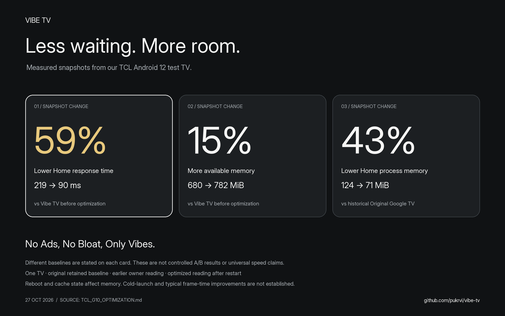
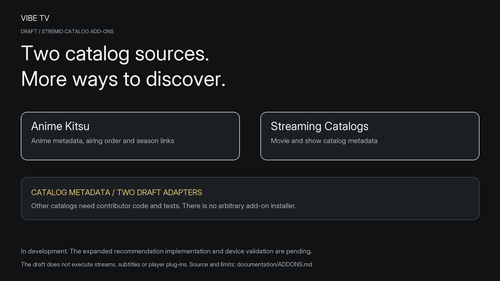
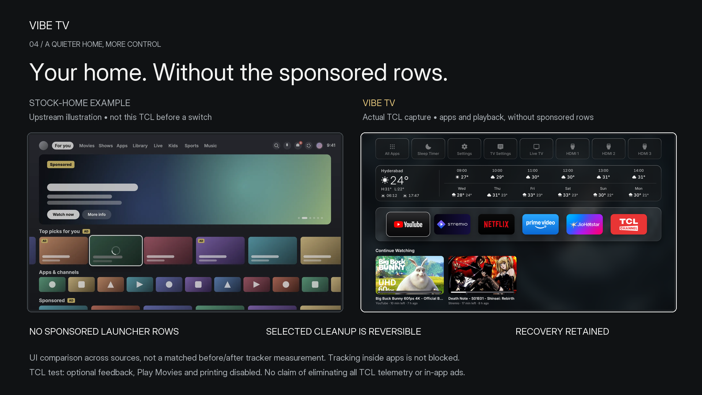

# Vibe TV documentation

Use these guides to install Vibe TV, understand its features, or test it on another TV. This page is the GitHub Wiki's Home page. The README remains the shorter project introduction.

[Install](../INSTALLATION.md) · [Feature status](../FEATURES.md) · [Hardware and apps](../COMPATIBILITY.md) · [Contribute](../CONTRIBUTING.md) · [Privacy](../PRIVACY.md) · [Security](../SECURITY.md)

## Recommendations

The current For You, Anime, Movies and TV Shows shelves use TMDB picks filtered to installed services. This earlier TCL detail capture shows For You and Anime. The new Stremio/Kitsu engine remains in development; this image does not show that implementation.

[Recommendation behavior and upcoming work](FEATURE_STORIES.md#recommendations) · [Capture provenance](SCREENSHOTS.md#current-recommendation-shelves-earlier-capture)

## Continue Watching

The published TCL capture shows YouTube and Stremio artwork/progress. Reopening a specific title or saved position depends on the streaming app and build. Netflix and Prime have metadata limits; the separate saved-resume hotfix remains subject to its PR landing.

[Feature guide](FEATURE_STORIES.md#continue-watching) · [Provider results](../PLAYBACK_STATUS.md) · [Hardware and app matrix](../COMPATIBILITY.md)

## Performance and complete comparisons

The Original Google TV readings are historical. The earlier Vibe readings came from the owner; optimized values followed a restart. These are snapshots under different conditions, not a controlled three-way benchmark. The separate warm-return test measured 80 versus 63 ms; better cold-start and typical frame times were not established.

[Full results, raw values and recovery](TCL_G10_OPTIMIZATION.md) · [Image data and formulas](performance/README.md)

## Stremio catalog add-ons

Anime Kitsu and Streaming Catalogs are the two adapters being developed. They read catalog metadata; arbitrary add-on installation and stream/subtitle execution are outside that draft.

[Add-on scope and contribution requirements](ADDONS.md)

## Ads and optional collection

Vibe TV has no sponsored launcher rows. The TCL test also disabled optional Google feedback, Play Movies and printing reversibly. The comparison uses an upstream illustration and a real Vibe capture, not matched before/after tracker measurements. In-app ads and all TCL telemetry are not blocked.

[Audit and cleanup details](TCL_G10_OPTIMIZATION.md#cleanup-and-recovery) · [Privacy policy](../PRIVACY.md)

## Settings, layout and themes

Capture dates and build versions differ. The gallery labels each image, including historical theme evidence, branded app-art fallbacks and the earlier reboot capture.

[Complete screenshot gallery and provenance](SCREENSHOTS.md) · [Design and remote navigation](../DESIGN.md) · [Settings verification](../design/SETTINGS_VERIFICATION.md)

## Build, test and contribute

[Installation](../INSTALLATION.md) covers Android TV plus the inherited webOS/Tizen packages. [Contributing](../CONTRIBUTING.md) covers patches, translations and hardware reports. Device testing follows the [Android TV runbook](../ANDROID_TV_TESTING.md); the [compatibility matrix](../COMPATIBILITY.md) states what was actually tested.

[Editable SVG/PNG assets and the one-minute video plan](feature-assets/ASSET_GUIDE.md) · [Wiki publication from these same source files](WIKI.md) · [Credits and license](../CREDITS.md)
