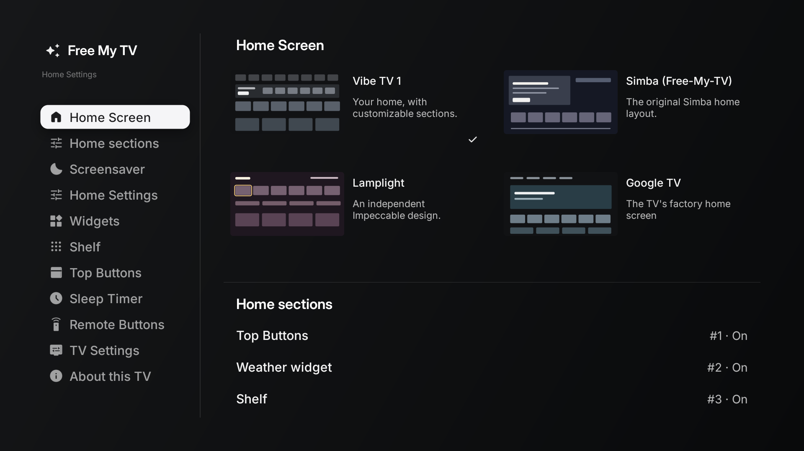
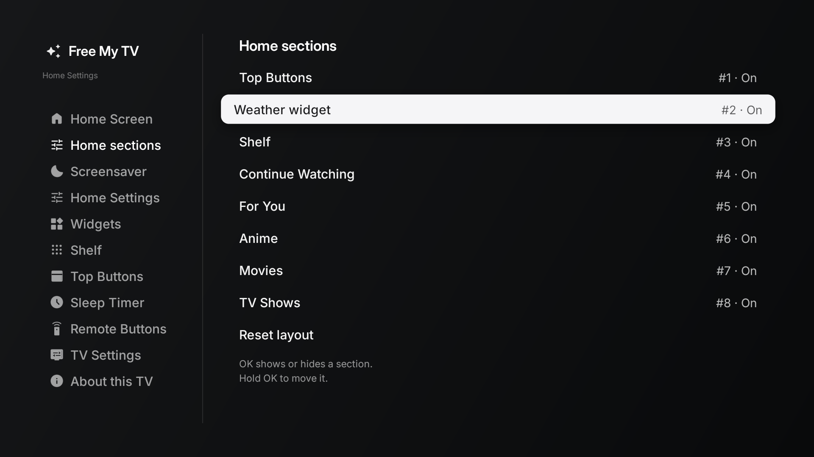
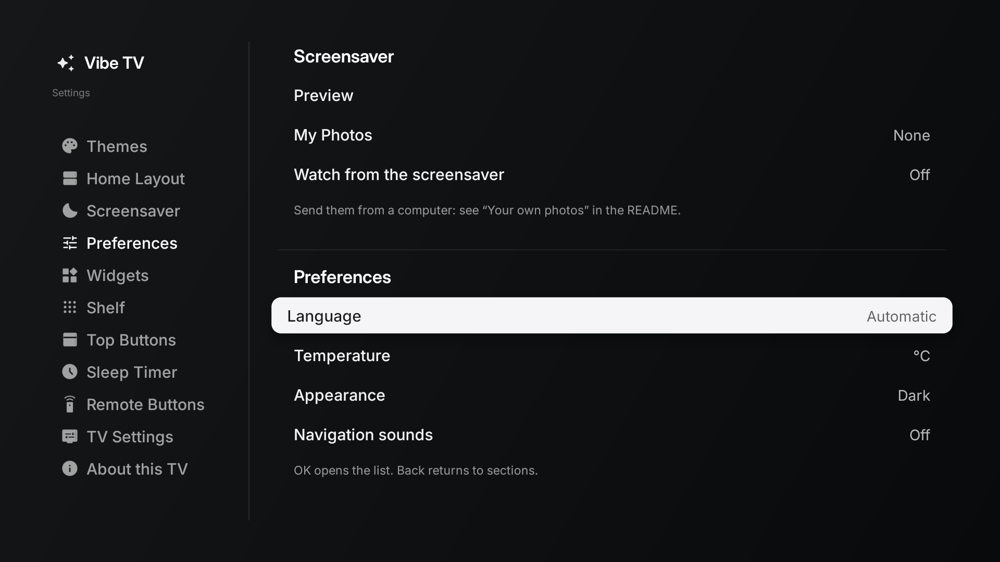
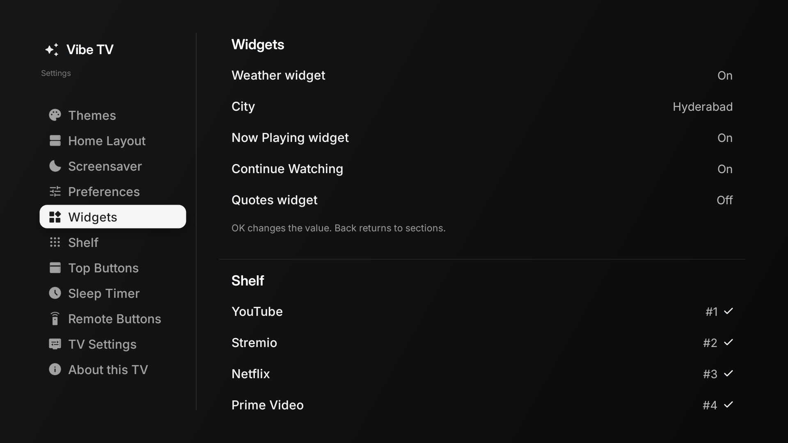
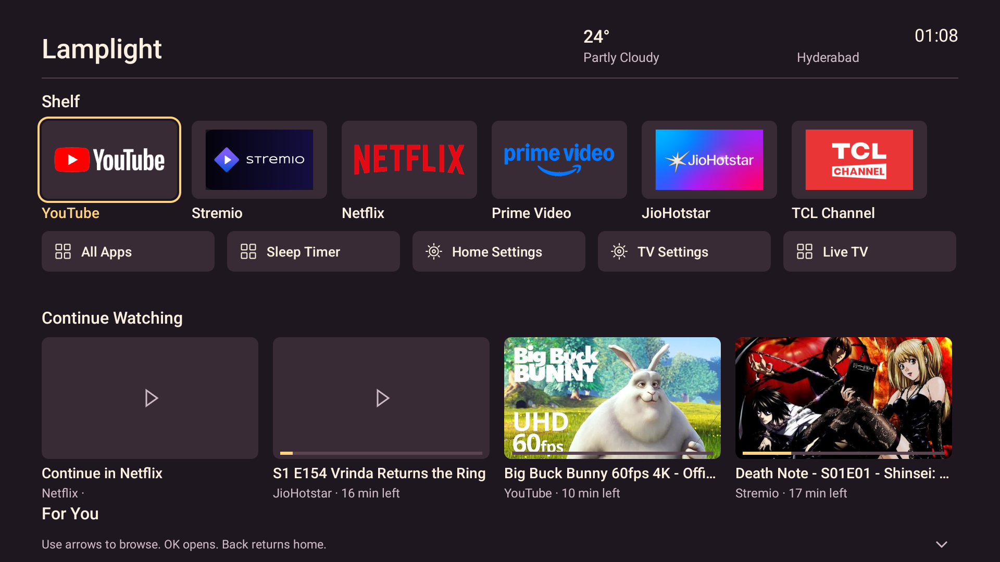
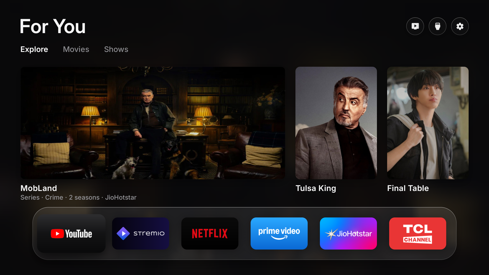
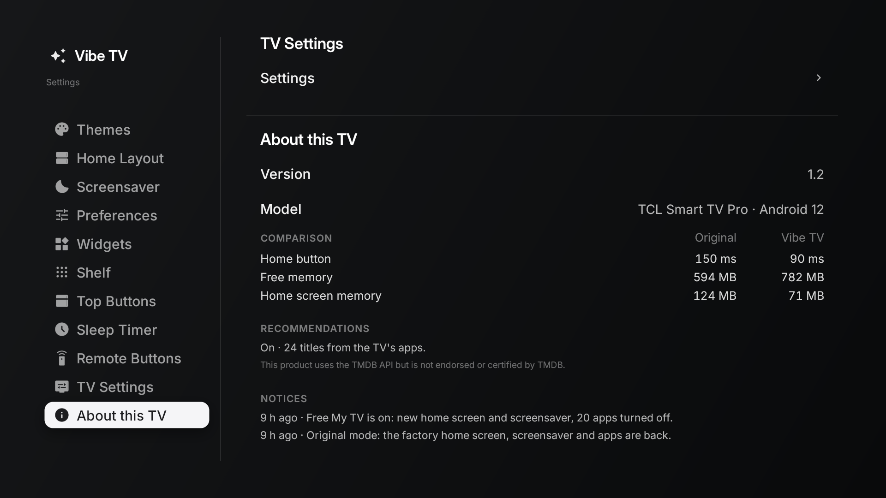

# Vibe TV screenshot record

[Project](../README.md) · [Feature register](../FEATURES.md) · [Settings polish evidence](../design/SETTINGS_CLARITY_VERIFICATION.md) · [Earlier Settings evidence](../design/SETTINGS_VERIFICATION.md)

Updated October 27, 2026. These are genuine 1920 × 1080 TCL Android 12 captures, inspected at full resolution. The current Settings captures come from `b88a229` (Vibe TV branding and clearer destinations) built on integrated main `a493c66`, preserving Settings `e740614` and playback `9d4473b`. The home capture is refreshed from `3e382d0`, which includes that Settings polish plus branded app-art fallback cards. Alternative-theme captures below remain earlier device evidence, identified individually. These are source-build captures, not screenshots of a tagged binary release. Theme-picker thumbnails are illustrations; full-screen views are actual device captures.

| Checked-in capture | Original local capture | Provenance / observed state |
|---|---|---|
| [Final home](screenshots/home-playback.png) | `netflix-card-art/04-gallery-home.png` | Installed `3e382d0`; Vibe TV 1/default order, YouTube and Stremio artwork/progress. Netflix, JioHotstar and an older logo-only YouTube entry dismissed through normal card menus for the gallery view. |
| [Branded app-art fallback](screenshots/playback-app-art.png) | `netflix-card-art/01-branded-fallback.png` | Same installed build before the gallery cleanup; Netflix uses its installed app art like JioHotstar, while retaining the explicit Continue in Netflix caption. This is app branding, not a movie thumbnail. |
| [Theme picker](screenshots/settings-themes.png) | `settings-clarity/02-themes.png` | Installed `b88a229`; Vibe TV header, Themes palette icon, distinct Home Layout / Preferences destinations |
| [Widgets](screenshots/settings-widgets.png) | `settings-clarity/06-widgets.png` | Installed `b88a229`; updated rail labels, continuous Widgets and following Shelf content |
| [Home Layout](screenshots/settings-sections.png) | `settings-clarity/03-layout.png` | Installed `b88a229`; Home Layout editor, stacked-section icon, first row focused |
| [Lamplight](screenshots/theme-lamplight.png) | `final/09-lamplight.png` | Historical e740614 series before Settings naming polish; independent warm theme with playback row |
| [Simba (Free-My-TV)](screenshots/theme-simba.png) | `themes/05-simba-home.png` | Earlier theme-selection test in the same implementation series; original upstream layout preserved |
| [Preferences](screenshots/settings-preferences.png) | `settings-clarity/05-preferences-crossing.png` | Installed `b88a229`; right-side Down crossed into Language and updated the rail selection |
| [Earlier reboot evidence](screenshots/home-after-reboot.png) | `post-reboot-home.png` | Historical Home + initial playback baseline, before final themes/artwork; does not establish final-build reboot acceptance |

The source captures live under `/tmp/free-my-tv-tv-check/`. The refreshed home/app-art captures were taken on the TCL Smart TV Pro (retail reference 55Q6CS), Android 12, from app version 1.2 / version code 3. They include `b88a229` Settings behavior and `3e382d0` card rendering; the working tree had only documentation/capture changes after installation. Firmware/identity details and final integration checks are recorded in [integration verification](../design/INTEGRATION_VERIFICATION.md). Streaming-app versions were not recorded for the earlier provider tests. City weather and test title metadata remain visible; no network address, account identity or credentials appear in these captures.

## Final home

The image is an unedited hardware capture. The user requested an artwork-led gallery view, so logo-only entries were removed using the existing long-press menu before capture; this does not add thumbnail support to Netflix or JioHotstar. [The same build before cleanup](screenshots/playback-app-art.png) records Netflix’s branded fallback. Provider limits remain in [PLAYBACK_STATUS.md](../PLAYBACK_STATUS.md).

## Theme selection

## Home Layout: ordering and visibility

## Preferences

Language, temperature, Appearance and navigation sounds live here. Appearance means automatic/light/dark; Themes selects the home design.

## Continuous settings

## Additional home designs

## TCL performance after restart

Captured October 27, 2026 from optimization implementation `2554711` on the TCL Smart TV Pro, Android 12, at 1920×1080 after one restart. Inspected for visual clarity and private information. The current Vibe column shows 90 ms / 782 MB / 71 MB; MB labels represent MiB. Original values are retained historical measurements, not a fresh comparison. [Measurement method and limits](TCL_G10_OPTIMIZATION.md). Later recovery/cache hardening has host coverage but is not represented by this installed build.

## Updating the gallery

After runtime changes, capture an identifiable combined build and record commit, dirty state, build/version, exact model, OS/firmware, date, remote state and toggles. Inspect the whole image and review location, viewing history and account details before publication. Prefer public test content. Keep fallback states visible when they explain a limitation. Update the associated test result rather than inferring playback or recovery success from a screenshot.

`docs/assets/` and `.github/preview.webp` contain inherited upstream demos; they are not current Vibe TV acceptance evidence.

## Current recommendation shelves, earlier capture

A detail crop of the earlier `feedback-anime.png` hardware capture: source rectangle `(0, 290, 1920, 1080)`, exported at 1920 × 790. The crop removes the Continue Watching history above the recommendation shelves; the remaining pixels are unchanged. It shows the existing TMDB For You and Anime rows, not the new Stremio/Kitsu engine. The exact source build hash was not recorded alongside this capture. Titles and app names are catalog recommendations, not an account-history claim. The full source stays local under `/tmp/free-my-tv-tv-check/`.
